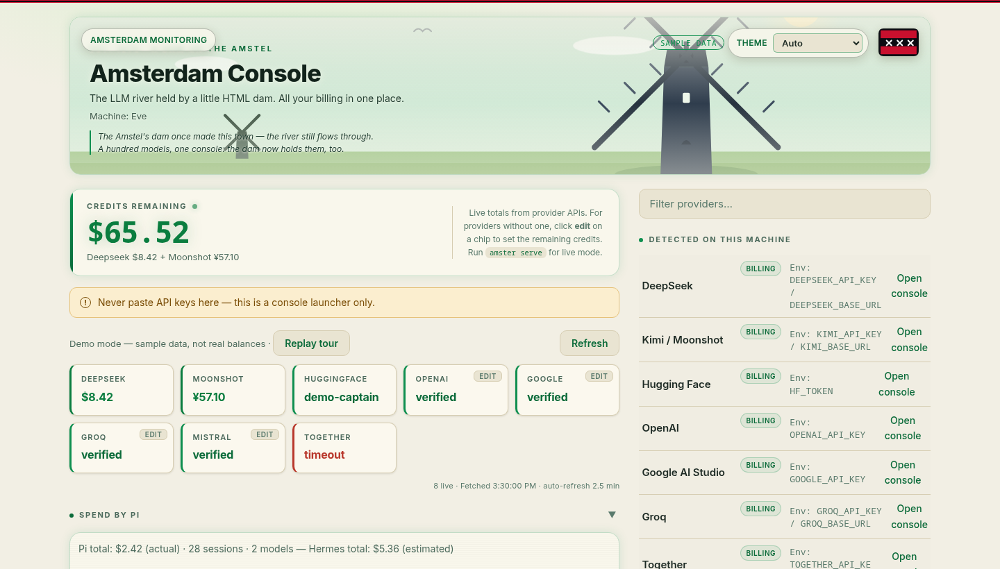

# Amsterdam Console

> **Amsterdam:** every LLM billing console in one place. Run `amsterdam` to open the gates.

[](https://github.com/paraguadiosa/amsterdam/actions/workflows/ci.yml)
[](LICENSE)
[](#requirements)

A static panel to open all LLM billing consoles from one place — with
live balance and usage numbers fetched straight from provider APIs.

**Live demo:** [Amsterdam demo](https://evecoronel.com/amsterdam/?demo) — sample data, no keys, no signup. Served from the [`astrocronopio.github.io`](https://github.com/paraguadiosa/astrocronopio.github.io) repository (custom domain `evecoronel.com`).



## Features

- **One dashboard for all consoles** — a chip per provider, each opening
  its billing console in a new tab. Search filters chips live.
- **Live balances** — real money numbers from providers with billing APIs
  (DeepSeek, Moonshot), refreshed every 2.5 minutes.
- **Key verification** — providers without a billing API report whether
  the key is valid (HTTP 200 on `/v1/models`) and how many models it can
  see.
- **Credits remaining panel** — the live sum of all provider balances,
  with a per-provider split. Manual balances are supported for providers
  without an API.
- **Monitoring via Grafana** — the only monitoring surface. The header
  links to the Agent Telemetry dashboard (Prometheus-backed,
  `http://mini.tail66290a.ts.net:3005/d/agent-telemetry`, override with
  `?grafana=URL`): per-orchestrator cost, tokens and sessions live there.
  The link is hidden in public demo mode (`?demo`).
- **Two serving modes** — live local daemon with an HTTP API, or a static
  `file://` snapshot with no server at all.
- **Demo mode with onboarding** — `?demo` in the URL loads sample data and
  a guided tour, so visitors can try the dashboard without any keys.
- **Docker support** — a small `node:22-alpine` image that runs as a
  non-root user, with a built-in health check.
- **No build step** — a single HTML file and plain Node modules. No
  bundler, no framework.
- **Secrets safe by default** — keys live in environment variables or the
  Hermes credential pool, never in git. Gitleaks hooks block accidental
  commits and pushes of secrets.
- **Four bio-luminescent themes** — Dusk, Cyber Neon, Alien Green, and
  EcoPunk palettes over glassmorphism panels, HUD glow, and CRT
  scanlines, with the Amsterdam canal-city hero (gabled houses and
  windmills by night, green polder by day). Alien Green brings a UFO
  over the canal houses (the Green Light District); EcoPunk sets the day
  scene in the Amsterdamse Bos with a grove on the dike. The picker in
  the hero remembers your choice; `auto` follows the clock (EcoPunk day
  in the Bos 07:00-19:59). Deep-link a palette with `?theme=alien` or
  `?theme=solar` — the choice is applied before first paint and
  remembered like any other picker choice.

## Requirements

- **Node.js 22 or newer** (the app uses `node:test`, `fetch`, and ESM).
- **curl** — used by the CLI helpers to probe the daemon.
- **Docker** — optional, only for the container mode.
- **bats** and **npm** — only needed to run the test suite.

The runtime itself has zero npm dependencies beyond Node built-ins.

## Quick start

### 1. Clone and configure

```bash
git clone git@github.com:paraguadiosa/amsterdam.git
cd amsterdam
cp .env.example .env    # then fill in your API keys
```

### 2. Install the CLI (once)

```bash
./scripts/amsterdam-install   # symlinks amsterdam into ~/.local/bin
```

### 3. Run

```bash
amsterdam                     # start the daemon in the background, print the URL
```

The first `amsterdam` starts the host daemon in the background (the
command returns to the prompt immediately) and prints the live URL
(<http://localhost:3131>). It does not open a browser on that first call.
When the daemon is already running, `amsterdam` opens the dashboard
in your browser instead. Use `amsterdam serve` for a foreground debug
daemon (Ctrl+C to stop).

The landing page (`/`) is the billing console. Per-orchestrator
monitoring lives in Grafana — the header links to the Agent Telemetry
dashboards.

No API keys yet? The dashboard still works — chips show `unverified`
until a key is found. Want to look around first? `amsterdam demo` opens
the dashboard with sample data and the onboarding tour.

### Opt-in: Docker container

```bash
amsterdam docker    # background container, then print the URL
amsterdam stop      # stop the container
```

The Docker image is rebuilt on `amsterdam build`. Prefer the daemon while
iterating on code — the container runs the code baked at build time.

For a one-shot snapshot instead:

```bash
./scripts/amster dump    # fetch billing data once, write data/billing.js
./scripts/amster open    # open the static dashboard (file://)
```

## CLI reference

```
amsterdam               # Start the daemon in the background, or open the dashboard
amsterdam serve         # Foreground debug daemon (Ctrl+C to stop)
amsterdam start         # Start the daemon in the background (same as no arguments)
amsterdam status        # Show whether the host daemon is running
amsterdam open          # Open the dashboard in a browser
amsterdam demo          # Open the dashboard with sample data and the tour
amsterdam docker        # Background Docker container, then print the URL
amsterdam up            # Same as docker
amsterdam stop          # Stop the background container
amsterdam build         # Build the Docker image
amsterdam run           # Run Docker in the foreground (Ctrl+C to stop)
amsterdam dump          # Fetch billing data once (open the floodgates)
amsterdam link          # Show the file:// URL
amsterdam path          # Show the absolute path
amsterdam help          # Show help
```

The wrapper starts the host daemon by default, passes
`docker|up|stop|build|run` to `scripts/amster-docker`, and the rest to
`scripts/amster`. The low-level helpers work the same way:

```bash
./scripts/amster start    # Start the daemon in the background, print the URL
./scripts/amster status   # Show whether the daemon is running
./scripts/amster stop     # Stop the background daemon
./scripts/amster serve    # Live server in the foreground (Ctrl+C to stop)
./scripts/amster dump     # Fetch billing data once (open the floodgates)
./scripts/amster open     # Open the dashboard in a browser
./scripts/amster demo     # Open the dashboard with sample data and the tour
./scripts/amster link     # Show the file:// URL
./scripts/amster path     # Show the absolute path
./scripts/amster help     # Show help
```

The daemon state lives in `data/` (gitignored): `data/amsterdam.pid`
holds the pid of the background daemon and `data/amsterdam.log` its
output. `amster stop` reads the pidfile and kills exactly that process.

### Environment variables

| Variable | Default | Purpose |
|----------|---------|---------|
| `PORT` | `3131` | Port for the daemon and the container |
| `AMSTERDAM_OPEN` | `xdg-open` | Browser opener command (set to `echo` for headless use) |
| `CODEX_AUTH_FILE` | `~/.codex/auth.json` | Codex auth file path |
| `AMSTERDAM_BIN_DIR` | `~/.local/bin` | Install target for `amsterdam-install` |

## Configuration — credentials in one place

Amsterdam reads credentials from five sources, in order. The first source
that defines a variable wins:

1. `process.env` (already exported in your shell)
2. `./.env` in the project directory
3. `~/.hermes/.env`
4. **`~/.hermes/auth.json`** — the Hermes credential pool
5. **`~/.codex/auth.json`** — the Codex auth file (apikey mode)

The Hermes credential pool is the recommended source. Keys added with
`hermes auth add <provider> --api-key <key>` are picked up automatically.
Hermes provider ids are mapped to Amsterdam variables (for example
`kimi-coding` → `KIMI_API_KEY`). Only manual credentials carry a token;
env-sourced ones resolve through the `.env` files above. The pool's
`base_url` is also honored for providers that read one
(`KIMI_BASE_URL`, `DEEPSEEK_BASE_URL`, `GROQ_BASE_URL`), with the
OpenAI-style trailing `/v1` stripped.

The Codex auth file covers providers configured outside Hermes, such as
an OpenAI key stored by `codex` in apikey mode. File keys are env-var
names (for example `OPENAI_API_KEY`); only keys matching a catalog
`envKey` are picked up. Override the path with `CODEX_AUTH_FILE`.

So you maintain your keys in **one place** (`hermes auth`), and Amsterdam
detects them without duplicating them in a project `.env`.

All supported variables are listed in [`.env.example`](.env.example).
Copy it to `.env` and fill in the keys you have. `.env` is git-ignored —
it must never be committed.

## Demo mode — show it to other people

Add `?demo` to the URL and the dashboard runs on the sample fixture in
`demo/billing.js` instead of real data. No keys, no daemon, no Hermes
or Codex data — nothing leaves the visitor's browser. A **Sample data**
badge marks the page, live polling is off, and the dashboard's
six-step onboarding tour auto-starts on the first visit.

```bash
amsterdam demo    # open the dashboard demo locally
```

Pin a palette on any demo URL with `?theme=`, for example
`?demo&theme=solar` (EcoPunk day in the Bos) or `?demo&theme=alien`
(the Green Light District). The choice is applied before first paint and
saved, so the picker in the hero shows it on the next visit.

Live copies are published at
<https://evecoronel.com/amsterdam/?demo>, served from the `amsterdam/`
directory of the
[astrocronopio.github.io](https://github.com/paraguadiosa/astrocronopio.github.io)
repository (its Pages custom domain is `evecoronel.com`).

To publish the demos on a static host (for example your own domain),
copy these files to the web root — no server code needed:

```
index.html
src/      # themes, provider catalog
 demo/     # the sample fixture
```

Then link visitors to `https://your-domain.example/?demo`. The fixtures
contain only made-up numbers, so they are safe to publish; the test suite
(`tests/demo.test.js`) asserts they carry no key-shaped strings. Without
`?demo` the same files render the normal empty state.

## Live mode vs static mode

| Mode | Command | Data | Refresh |
|------|---------|------|---------|
| Live | `amster serve` | `/api/billing` endpoint | Every 2.5 min, plus manual Refresh button |
| Static | `amster dump` + `amster open` | `data/billing.js` | None (snapshot) |

The dashboard detects how it is served. Over HTTP it polls `/api/billing`
and shows a live status; over `file://` it renders the static snapshot
and suggests `amster serve`. `amster open` opens the live URL when the
daemon is running and falls back to the static file otherwise.

## Credits and manual budgets

The dashboard leads with a big **Credits remaining** panel: the live sum
of all provider balances with real billing APIs (DeepSeek, Moonshot),
plus a per-provider split. It updates with every 2.5-minute auto-refresh,
so the number on screen is always how much money is left in the accounts.

Providers without a billing API (the verified-only providers) cannot
report a balance — the API simply has no public credits endpoint (this is
why Anthropic was purged from the console). For those, click **edit** on
the chip and type the remaining amount once; it is stored server-side in
a small SQLite database at `data/manual-credits.db` (live mode), shown
as a USD value, and added to the total (marked *manual* in the split).
Because the store is server-side, every browser on the machine (the
Dell, the phone, the Win Mini) shares the same manual balances.
localStorage under `amsterdam.manualCredits` remains only as a fallback
when the server is unreachable, or in static/demo mode.

The store is a plain key-value table (`provider` → `amount`). The
daemon exposes it over HTTP:

- `GET /api/manual-credits` — the whole map as JSON, e.g. `{"pi": 50}`.
- `POST /api/manual-credits` with `{"provider": "pi", "amount": 50}` —
  upsert a credit (provider must be a catalog id or `pi`; amount a
  finite number ≥ 0). Sending `"amount": null` deletes the entry.
  Invalid bodies get `400` with an `error` message.

### Pi chip

The dashboard shows a **Pi** chip in the summary row when a manual Pi
credit exists. Pi has no balance API, so the chip is a budget: set the
credit once via the chip's **edit** button and the chip shows the
remaining amount. The value is excluded from the HUD credits total —
Pi is a budget, not a wallet balance. A POST to `/api/manual-credits`
invalidates the 60-second billing cache so the chip updates immediately.

### Monitoring via Grafana

Amsterdam renders no spend or usage charts: the observability stack
(Prometheus + Pushgateway + Grafana, see `~/repos/observability`) is the
monitoring surface. Every agent pushes full accumulated totals to the
Pushgateway; Grafana renders cost, tokens and sessions per orchestrator.
The console header links to the Agent Telemetry dashboard
(`http://mini.tail66290a.ts.net:3005/d/agent-telemetry`); override with
`?grafana=URL` when Grafana lives elsewhere.

## Architecture

```
src/
  providers/
    catalog.js       # Single source of truth for every provider
    deepseek.js      # Balance fetcher (custom, keyed by catalog id)
    moonshot.js      # Balance fetcher (custom, keyed by catalog id)
    huggingface.js   # Whoami fetcher (custom, keyed by catalog id)
    verify.js        # Generic key-verification factory
    index.js         # Builds the runtime registry from the catalog
  dam.js             # Orchestrator — fetches all, writes data/billing.js
  server.js          # Local HTTP server for live mode
  env.js             # Credential loader (.env files + Hermes pool + Codex auth)
  manual-credits.js  # Server-side manual credit store (node:sqlite)
  themes.js          # Palette registry — one entry per theme, no CSS per theme
  format.js          # Output formatters (JS file + console)
data/
  billing.js         # Auto-generated (gitignored)
  manual-credits.db  # Manual credit store, created on first use
demo/
  billing.js         # Sample fixture for demo mode (?demo) — safe to publish
index.html           # Dashboard — reads data/billing.js and /api/billing
Dockerfile           # Container build (node:22-alpine, runs as non-root)
.dockerignore        # Keeps the build context small
scripts/
  amster             # CLI entry point (serve, dump, open, ...)
  amsterdam          # Wrapper: default to host daemon, Docker via `amsterdam docker`
  amsterdam-install  # Symlink the commands into ~/.local/bin
  amster-docker      # Docker build/run helper
  sync-providers     # Regenerate .env.example from the catalog
```

### Provider types

| Type | Providers | What it returns |
|------|-----------|-----------------|
| Balance API | DeepSeek, Moonshot | Actual balance numbers |
| Account info | Hugging Face | Username + verified status |
| Key verification + model count | OpenAI, Groq, Together, Mistral, Google, Fireworks, xAI | Number of models + `verified: true` on HTTP 200 |
| Link only | Local llama.cpp, Google Cloud Billing | No API — console link only |

### Adding a provider (automatic)

Everything is derived from `src/providers/catalog.js`. To add a
provider such as xAI, add one object there, then refresh `.env.example`:

```bash
node scripts/sync-providers
```

That is all. The runtime registry (`src/providers/index.js`), the
dashboard card (rendered from the catalog in `index.html`), and the
Hermes credential-pool mapping (`src/env.js`) all read the catalog, so
they pick up the new provider without further edits.

Most providers are `kind: 'verify'` — they only verify the key against
`/v1/models`, so a catalog entry is the whole job. A provider with a
real balance or account endpoint needs a small custom fetcher in
`src/providers/<id>.js` plus a line in the `CUSTOM_FETCHERS` map in
`src/providers/index.js`. The tests in `tests/providers.test.js` show
both shapes.

## Testing

```bash
npm install            # one-time, for the coverage tool (c8)
npm test               # Node.js tests with coverage (fails below 80% lines)
npm run test:shell     # Shell + HTML tests (bats)
npm run test:all       # Both
```

The suite covers the providers, the credential loader, the HTTP server,
the theme registry, the CLI scripts, and the dashboard HTML.

## CI

`.github/workflows/ci.yml` runs on every push and pull request:

1. **Test** — installs dependencies, runs Node tests (80% coverage gate)
   and the bats suite.
2. **Docker** — builds the image and smoke-tests `/` and `/api/billing`.

## Contributing

Contributions are welcome. The project is small on purpose — keep it that
way.

1. **Fork** the repository and create a branch:
   `git checkout -b my-feature`.
2. **Make the change.** Keep it scoped; the single-HTML-file constraint
   applies to the dashboard.
3. **Test it.** Run `npm run test:all` and keep the Node coverage at or
   above 80%.
4. **Install the git hooks** (once): `git config core.hooksPath .githooks`.
   The pre-commit hook scans staged files with
   [gitleaks](https://github.com/gitleaks/gitleaks); the pre-push hook
   scans the outgoing commit range and **fails closed** if gitleaks is
   missing — install it before pushing.
5. **Open a pull request** describing what changed and why.

Style notes: plain Node modules with `node:` prefixed imports, no
framework, no bundler, comments kept minimal. Shell scripts stay POSIX
`/bin/sh`. Secret-checking is not optional — real keys in the repo must
be rotated immediately.

## Security

- No secrets are stored in the repo. Keys come from environment
  variables or the Hermes credential pool (`~/.hermes/auth.json`).
- `.gitignore` is hardened and `.env.example` ships empty.
- Gitleaks pre-commit and pre-push hooks block accidental leaks.
- The Docker container runs as a non-root user and mounts the keys file
  read-only.
- The daemon binds to `127.0.0.1` only and rejects requests with a
  foreign `Host` header, so LAN peers and DNS-rebinding websites cannot
  read billing data or write credits. `POST /api/manual-credits` also
  rejects cross-origin requests. Set `AMS_HOST` to expose the daemon on
  another interface explicitly.
- `?fresh` refreshes are throttled (5 s minimum) so the daemon cannot be
  used to hammer your provider accounts.
- Generated data files (`data/billing.js`, `data/manual-credits.db`)
  are created owner-only.

To report a vulnerability, open a GitHub issue with the label `security`
or contact the maintainers privately. Do not open a public issue that
contains real keys.

## License

[MIT](LICENSE) — see the [LICENSE](LICENSE) file.

## Related projects

- **Hermes** — the local agent whose credential pool
  (`~/.hermes/auth.json`) feeds provider detection. Amsterdam reads it
  read-only.
- [Codex](https://openai.com/codex) — the CLI whose auth file
  (`~/.codex/auth.json`) feeds OpenAI key detection in apikey mode.
